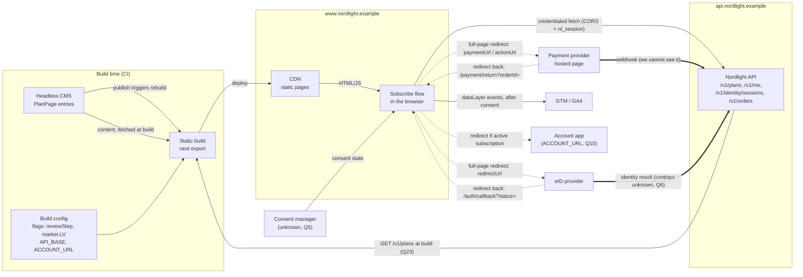

# System context

The systems the frontend depends on, the systems that depend on it, and the cross-origin rules that hold them together. Q-numbers refer to `03-open-questions.md`.

Sources: Brief = `docs/01-product-brief.md`, API = `docs/02-api-notes.md`, CMS = `docs/03-cms-content-model.md`, GA = `docs/04-analytics-notes.md`, Mock = `mock-server/README.md`.

## Diagram

Solid = data the app fetches or pushes. Dotted = full-page browser navigation. Thick = server-to-server, invisible to the frontend.

## Upstream: systems we depend on

| System | Owner | How we talk to it | What we use it for | What the user sees if it fails |
|---|---|---|---|---|
| Nordlight API: `GET /v1/plans` | Backend | Fetched at build for first paint. Fetched again at runtime with credentials before Review (Q23) | Plan list per market, `priceNet`, `vatRate`, `currency` (Q2, Q26) | Runtime fetch before Review fails: error with retry, and the user can't continue to payment on a stale price |
| Nordlight API: `GET /v1/me` | Backend | Credentialed fetch on load and after eID return | Is the user identified? Active subscription (redirect, Q10)? `trialEligible` (Q12) | `401`: treated as "not identified", the normal path |
| Nordlight API: `POST /v1/identity/sessions` | Backend | Credentialed fetch. Returns `redirectUrl` | Start eID | `429`: "try again in N s", using `Retry-After` (Q18) |
| Nordlight API: `POST /v1/orders`, `GET /v1/orders/{id}` | Backend | Credentialed fetch. Body includes `market` (Q1: the API notes list only `planId`, so this goes beyond the docs) and `returnUrl`. Status is polled (Q9) | Create the order, get `paymentUrl`, track status | `401`: restart from eID (Q17). `409 already_subscribed`: redirect to account (Q10). The button stays disabled while a request is in flight (Q19) |
| eID provider | External (contract through Backend) | Full-page redirect out to `redirectUrl`, back to `/auth/callback?status=ok\|cancelled\|expired` (Q6) | Identify the user. Sets `nl_session` (mechanism unknown, see note) | `cancelled` or `expired`: message and a "try again" button on the eID step. Returns without a session (other browser, Q7): "continue in this browser" plus restart. Provider down: the user is stuck on the provider's page and we can't detect it |
| Payment provider | External (contract through Backend) | Full-page redirect out to `paymentUrl` (or `actionUrl` for `requires_action`), back to `/payment/return?orderId=…[&cancelled=1]` (Q6) | Take payment, or capture a card for a trial (Q4) | `cancelled=1`: the user can try again, and each attempt creates a new order (Q19). Where the user lands is defined in `04-user-flow.md`. Decline: polling sees `failed`, message plus retry. Provider down: stuck on the provider's page and we can't detect it |
| Payment webhook → API | Backend + provider | Not visible to us. We only see its effect through `GET /v1/orders/{id}` | Moves the order to `paid`, `failed` or `requires_action` | Slow: "still confirming" after 20 s. After 3 min: "we'll confirm shortly" with a safe exit (Q9) |
| Headless CMS | Marketing | Fetched at build only (mock: `GET /cms/v1/plan-pages`). Publishing triggers a rebuild | Headline, plan cards, badges, `legalText`, FAQ. Never `priceLabel` (Q2) | An empty `legalText` fails the build (Q13). A CMS card with no matching API plan is hidden (Q8). An API plan with no CMS card is not covered by any source |
| Build config | Frontend + Platform | Env vars read at build | Flags `reviewStep` (on), `market.LV` (off). `API_BASE`, `ACCOUNT_URL`, `CONFIG_URL` | A wrong value ships until the next deploy. A build flag change needs a rebuild |
| Runtime config (prod) | Frontend + Platform | JSON at `CONFIG_URL`, short cache (10, Q49) | `reviewStep` arm share, `checkout.paused.{market}` | Fetch fails: build defaults (Review on, not paused) |
| CDN / static host | Platform | Serves the `output: 'export'` files. Also sets security headers (CSP), because there is no app server | Delivers every page, including both callback pages | Site down. Callback pages unreachable: the user returns from a provider to an error page |
| Consent manager | Marketing + Legal | Unknown (Q5). Assumed GTM Consent Mode v2 | Gate for GA events and UTM persistence | Fails or blocked: no analytics, the flow keeps working |

### Note on Q6: who sets the session cookie?

The API notes say the eID provider sends the user back to `/auth/callback`. That route is on `www`, which is a static export with no server code. So the API never sees the eID result directly. The API can only set `nl_session` if one of these holds:

- the provider redirects to an API endpoint first, which sets the cookie and then redirects to `www/auth/callback`; or
- the provider calls the API server-to-server (like the payment webhook); or
- `/auth/callback` receives a code that the app sends to the API, and the API sets the cookie in its response.

The mock avoids the problem: its fake eID page runs on the API origin and sets the cookie itself. Working assumption: as in Q6, the mock behaviour is the contract, so after `?status=ok` the cookie is already there and the app only calls `GET /v1/me`. If Backend picks the code-exchange option, the callback needs one more API call. Q7's `state` parameter belongs in the same answer.

## Downstream: systems that depend on us

| System | Owner | What it depends on from us | Contract / reference |
|---|---|---|---|
| GA4 via GTM | Marketing | The exact event names (`plan_viewed` … `purchase`). `purchase` with `transaction_id`, `value`, `currency`, fired once per order. UTMs kept until `purchase` | GA. Q4 (value), Q5 (consent), Q20 (dedupe, params) |
| Nordlight API | Backend | `market` in the order body (Q1). `returnUrl` on our origin that carries flow context (Q7). No double submits (Q19) | API, Q1, Q7, Q19 |
| eID and payment providers (via the API's return-URL allowlist) | Backend | Stable callback paths `/auth/callback` and `/payment/return` on the production origin. The mock allowlist is `localhost`, `127.0.0.1` and `WEB_ORIGIN`. The production allowlist is not documented (Q6) | Mock, Q6 |
| Account app | Product | Our redirect of active subscribers to `ACCOUNT_URL` (Q10) | Q10 |
| Marketing's CMS publishing | Marketing | Our build turns a publish into a live page. Our build validation (Q13) can block a publish from going live | CMS, Q13 |

## Cross-origin requirements

Nothing in this section is documented for production. The mock only enables credentialed CORS for `localhost` and `127.0.0.1`. These are requirements for Backend and Platform.

### Same-site, cross-origin

- `www.nordlight.example` and `api.nordlight.example` are different **origins**, but the same **site** (`nordlight.example`). Because they share a site, `nl_session` counts as a first-party cookie. Safari ITP and third-party cookie blocking don't apply.
- **This design only works while the API stays under `nordlight.example`.** If the API moves to another registrable domain, the cookie becomes third-party and Safari and Firefox block it.

### CORS on every `/v1` response

| Header | Value | Why |
|---|---|---|
| `Access-Control-Allow-Origin` | The exact requesting origin, taken from an allowlist (prod `https://www.nordlight.example`, plus staging and preview origins) | `*` is invalid together with credentials |
| `Access-Control-Allow-Credentials` | `true` | Otherwise the browser doesn't send `nl_session` and hides the response |
| `Vary` | `Origin` | Stops a CDN or proxy from serving one origin's CORS headers to another |
| `Access-Control-Expose-Headers` | `Retry-After` | Not on the CORS safelist. Without it, the 429 handling in Q18 can't read the header |

Preflight (`OPTIONS`): `POST` with `Content-Type: application/json` always triggers a preflight.

- `Access-Control-Allow-Methods: GET, POST`
- `Access-Control-Allow-Headers: Content-Type` (add `Idempotency-Key` if Q19 is accepted)
- `Access-Control-Max-Age`: long enough to save a round trip per POST on mobile. Chromium caps it at 7200 s.

**Error responses need CORS headers too**: 4xx, 5xx and 429. Without them, the browser reports a network error. The error adapter (Q18) then sees no status and no body, and can't show the right message.

### Session cookie `nl_session`

| Attribute | Value | Why |
|---|---|---|
| `HttpOnly` | yes | Already true in the mock. The app finds out about the session through `GET /v1/me`, never by reading the cookie |
| `Secure` | yes | HTTPS only |
| `SameSite` | `Lax` | Same-site fetches from `www` send it. Cross-site POSTs (CSRF) don't. `None` isn't needed. `Strict` risks problems right after the cross-site redirect back from eID |
| `Domain` | not set (host-only `api.nordlight.example`) | Only the API reads it. Don't widen it to `.nordlight.example` |
| Lifetime | ≥ 1 h (Q17) | Must cover eID → Review → payment → polling |
| Set by | Unknown, see the note on Q6 | |

Client side: every API call uses `fetch(..., { credentials: 'include' })`.

### Redirects and CSP

- Leaving for a provider is a top-level navigation (`window.location.assign`), so CORS doesn't apply. Only the provider's return-URL allowlist matters.
- `returnUrl` carries plan, market, locale and UTM (Q7). It must stay within the length limits of the providers and the API (not documented).
- The CDN sets the CSP, since there is no server. `connect-src` must include the API origin and GTM/GA endpoints, and `script-src` must include GTM. Provider pages are only navigated to, so they don't need CSP entries.

### Local (mock) vs production

| | Mock | Production |
|---|---|---|
| Origins | `localhost:3000` and `localhost:4010` (same host, different port) | `www.` and `api.` (same site, different host) |
| Cookie sharing | Browsers share `localhost` cookies across ports. Use `localhost`, never `127.0.0.1` | Works through same-site plus the CORS rules above |
| CORS | Allows `localhost` and `127.0.0.1` with credentials. More via `ALLOWED_ORIGINS` | Not configured yet: requirement on Backend |
| Who sets `nl_session` | The fake eID page, on the API origin | Unknown (note on Q6) |

So the mock can't catch a wrong production CORS or cookie setup. That needs a staging check on the real domains before launch.
